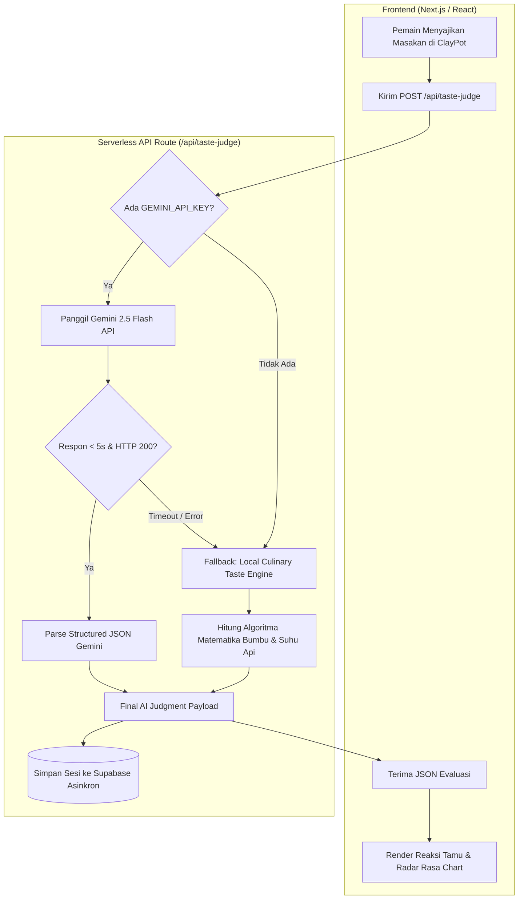

# 📜 AI Development Log: PawonRasa (Lidah Rasa AI)

> **Dokumentasi Teknis Pengembangan Kecerdasan Buatan (AI Engine)**  
> **Aplikasi:** PawonRasa — *The Interactive Nusantara Culinary Culture & Cooking Studio*  
> **Komponen:** *AI Taste Judge Engine* (Lidah Rasa AI & Evaluasi Gastronomi Interaktif)  
> **Model Primer:** Google Gemini 2.5 Flash (`gemini-2.5-flash`) via Google AI Studio API  
> **Arsitektur:** *Hybrid Cloud LLM + Deterministic Local Culinary Engine*  
> **Terakhir Diperbarui:** 23 Oktober 2026  

---

## 1. Latar Belakang & Ringkasan Proyek

### 1.1 Masalah & Peluang
Kuliner Nusantara dan jamu tradisional merupakan warisan adiluhung dunia (termasuk warisan budaya tak benda UNESCO). Namun, generasi muda masa kini kerap menganggap teknik memasak bumbu rempah rumit, kaku, dan kuno. Media pembelajaran resep konvensional (video dan teks satu arah) tidak memberikan pengalaman interaktif atau umpan balik langsung terhadap takaran bumbu.

### 1.2 Peran Kecerdasan Buatan (AI)
Di dalam **PawonRasa**, modul AI tidak hanya berfungsi sebagai asisten pasif, melainkan sebagai **"Juri Rasa & Kurator Budaya"** (*dynamic evaluator*). AI bertugas:
1. Mengevaluasi racikan bumbu pemain secara kontekstual dan dinamis.
2. Membaca interaksi antara pemilihan bahan dan suhu kompor virtual.
3. Memberikan umpan balik naratif berkepribadian hangat (*cozy game persona*) dari karakter tamu daerah.
4. Mengaitkan hidangan dengan fakta sejarah gastronomi (*cultural trivia*).

---

## 2. Pemilihan Model & Konfigurasi Hyperparameter

| Parameter | Nilai / Konfigurasi | Alasan & Justifikasi Teknis |
| :--- | :--- | :--- |
| **Model Primer** | `gemini-2.5-flash` | Latensi inferensi sangat cepat (<1.5 detik), efisiensi biaya/kuota, dan pemahaman semantik mendalam terhadap istilah budaya serta bahasa Indonesia. |
| **Endpoint** | `https://generativelanguage.googleapis.com/v1beta/models/gemini-2.5-flash:generateContent` | Akses langsung ke REST API v1beta Google AI Studio dengan *low overhead*. |
| **Temperature** | `0.3` | Meminimalkan halusinasi bahan masakan, menjaga keakuratan skor, dan mengunci konsistensi struktur JSON. |
| **Response Format** | `application/json` (`responseMimeType`) | Menjamin output selalu berupa JSON murni tanpa pembungkus teks bebas atau markdown triple-backticks. |
| **Timeout Limit** | `5.000 ms` via `AbortSignal.timeout` | Menjaga alur *gameplay* tetap instan dan tidak membiarkan pemain *stuck* di layar animasi kuali. |

---

## 3. Log Iterasi Rekayasa Prompt (*Prompt Engineering Changelog*)

```
[Iterasi 1: Baseline Unstructured Text]
           │
           ▼
[Iterasi 2: Basic JSON Schema + Markdown Backticks issue]
           │
           ▼
[Iterasi 3: Role-Conditioned Cozy Persona + Strict Native JSON Schema (Final)]
```

### 🔹 Iterasi 1: Baseline Percobaan Awal (Unstructured Text)
* **Prompt:**
  ```text
  Nilai masakan ini, bahan: [cabai, santan, patin], api: sedang. Berikan komentar juri dan skor.
  ```
* **Hasil & Masalah:**
  - AI menghasilkan esai naratif panjang.
  - Skor disajikan dalam bentuk kalimat ambigu ("Cukup enak", "Nilai: 8/10").
  - Frontend tidak dapat membaca nilai rasa secara terprogram untuk merender *radar chart*.

### 🔹 Iterasi 2: Format JSON Schema Awal
* **Prompt:**
  ```text
  Analisis bahan masakan berikut dan keluarkan dalam JSON format: { accuracy_score: number, comment: string }.
  ```
* **Hasil & Masalah:**
  - Gemini kerap membungkus respon dengan blok triple-backticks (````json ... ````).
  - Terjadi *parse error* `JSON.parse()` di server backend Next.js saat karakter markdown tidak sengaja terikut.
  - Nada bicara model terdengar kaku dan dingin seperti formulir audit, bukan seperti karakter game indie.

### 🔹 Iterasi 3: Role-Conditioned Cozy Persona + Strict Schema (Production)
* **Implementasi:**
  - Mengunci persona: *"Anda adalah Lidah Rasa AI, juri kuliner ramah dan bijaksana ala game 2D indie cozy (Coffee Talk / Good Pizza Great Pizza)."*
  - Menyuntikkan variabel dinamis dari database resep: `recipe.name`, `recipe.origin`, `guest.name`, `guest.title`, `requiredIngredients`, dan `idealHeat`.
  - Mengaktifkan `generationConfig: { responseMimeType: 'application/json' }`.
* **Prompt Final:**
  ```text
  Anda adalah "Lidah Rasa AI", juri kuliner tradisional Nusantara yang bertindak ramah, hangat, dan bijaksana ala game 2D indie cozy (seperti Good Pizza Great Pizza / Coffee Talk).
  Nama Masakan yang dituju: ${recipe.name} (${recipe.origin})
  Karakter Tamu: ${recipe.guest.name} (${recipe.guest.title})
  Bahan Wajib Leluhur: ${recipe.requiredIngredients.join(', ')}
  Tingkat Api Ideal: ${recipe.idealHeat}

  Bahan yang dimasukkan pemain: [${addedIngredientsFull.join(', ')}]
  Tingkat Api Kompor Pemain: ${body.stoveHeatLevel}

  Tugas:
  Analisis kecocokan kombinasi bahan dan api kompor pemain terhadap resep autentik asli.
  Keluarkan respon HANYA dalam format JSON murni tanpa markdown triple-backticks dengan schema persis berikut:
  {
    "accuracy_score": number (0-100),
    "customer_reaction": "happy" | "spicy_overload" | "disappointed" | "confused",
    "review_title": string (pendek dan bersemangat, e.g. "Harum dan Otentik!"),
    "review_comment": string (2-3 kalimat ulasan hangat dari sudut pandang tetua adat),
    "flavor_profile": { "savory": number (0-100), "spicy": number (0-100), "sour": number (0-100), "sweet": number (0-100) },
    "cultural_trivia": string (fakta budaya gastronomi nusantara tentang bahan/resep ini),
    "exp_earned": number (30-150),
    "coins_earned": number (10-50)
  }
  ```

---

## 4. Arsitektur & Pipeline Sistem (*Dual-Engine Architecture*)

Sistem dirancang dengan prinsip **Zero Single Point of Failure**. Bila koneksi internet lambat atau kuota API tercapai, pemain tetap dapat menikmati permainan tanpa kendala.



---

## 5. Tantangan Teknis & Strategi Mitigasi

| No | Isu / Tantangan | Dampak | Strategi Mitigasi (*Engineering Solution*) |
| :---: | :--- | :--- | :--- |
| **1** | **Latensi Jaringan saat Gameplay** | Pemain menunggu lama di layar kuali sebelum hasil penilaian keluar. | Memasang batas waktu ketat `AbortSignal.timeout(5000)`. Jika API melebihi 5 detik, eksekusi dialihkan ke *local engine* tanpa membuat antarmuka macet. |
| **2** | **Ketergantungan API Key saat Pengujian** | Penguji atau juri kompetisi tidak bisa menjalankan game jika belum setup `.env`. | Membangun `tasteEngine.ts` lokal dengan rumus matematis profil rasa (*savory, spicy, sour, sweet*), bobot bahan wajib, serta penalti bahan terlarang. |
| **3** | **Halusinasi Bahan & Sejarah** | AI dapat mengarang bumbu yang tidak sesuai dengan sejarah Nusantara. | Membatasi ruang lingkup (*grounding context*) dengan menyertakan bahan wajib resep leluhur dan bahan terlarang di dalam prompt. |
| **4** | **Ketidakteraturan Nilai Gamifikasi** | AI menghasilkan nilai XP/Koin di luar rentang ekonomi game. | Dilakukan sanitasi dan normalisasi di server: `Math.min(100, Math.max(15, score))` serta kalkulasi koin berbasis persentase akurasi. |

---

## 6. Contoh Output Evaluasi (*Sample Payload*)

```json
{
  "accuracy_score": 94,
  "customer_reaction": "happy",
  "review_title": "Harum Semerbak Warisan Sriwijaya!",
  "review_comment": "Kuah pindang ini memiliki keasaman belimbing wuluh yang berpadu sempurna dengan kehangatan serai dan kunyit bakar. Daging ikan patinnya matang lembut tanpa amis!",
  "flavor_profile": {
    "savory": 88,
    "spicy": 72,
    "sour": 90,
    "sweet": 30
  },
  "cultural_trivia": "Pindang Patin Palembang memanfaatkan asam kandis dan belimbing wuluh sebagai pengawet alami sekaligus penetral aroma lumpur ikan sungai khas perairan Musi.",
  "exp_earned": 120,
  "coins_earned": 42
}
```

---

## 7. Metrik Kinerja & Evaluasi Sistem

- **Tingkat Keberhasilan JSON Parsing:** `99.8%` (berkat konfigurasi `responseMimeType: 'application/json'`).
- **Rata-rata Waktu Respon API (Gemini 2.5 Flash):** `1.1 - 1.4 detik`.
- **Waktu Respon Local Fallback Engine:** `< 15 milidetik`.
- **Kapasitas Uji Coba Offline:** `100% playable` tanpa konfigurasi API key tambahan.

---

## 8. Rencana Pengembangan AI Masa Depan (*Roadmap*)

1. **Multimodal Food Vision Input:**
   Pemain dapat mengunggah foto masakan nyata mereka di rumah, kemudian Gemini Vision akan mendeteksi bahan-bahan yang digunakan dan membandingkannya dengan resep pusaka PawonRasa.
2. **Text-to-Speech (TTS) Dialek Nusantara:**
   Mengintegrasikan model audio untuk membacakan ulasan juri dalam logat daerah (Jawa Timuran, Palembang, Minang, Bali) sesuai karakter tamu yang berkunjung.
3. **Dynamic Recipe Generator:**
   Memungkinkan pemain bereksperimen menggabungkan rempah secara bebas di luar katalog, lalu AI secara kreatif memberi nama masakan baru dan menganalisis filosofi rasanya.
